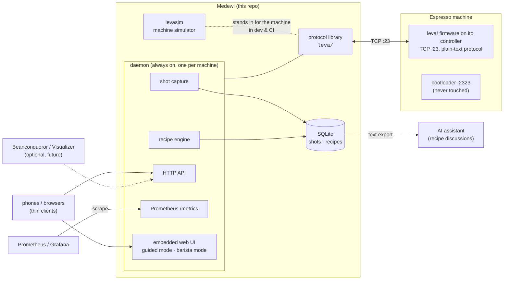

# Medewi — Architecture

For the "why" behind the shape described here, see the
[decision records](decisions/). For what the system is for, see
[use cases](use-cases.md).

## Components

## The pieces

- **Protocol library (`leva/`)** — owns the single TCP connection to the
  machine: sends commands, demultiplexes command responses from the
  continuous telemetry stream, decodes stream records using the firmware
  release's Status-Monitor XML as the format spec (loaded at runtime from a
  configured path — every installation has its own copy; it is vendor
  content and is never committed here).
- **levasim** — a fake leva! speaking the same TCP protocol, replaying
  fixtures recorded from a real machine. It is what makes development and
  CI possible without a hot espresso machine, and it carries a tripwire
  port that fails loudly if any tooling ever tries to reach a bootloader.
- **Daemon** — exactly one daemon owns machine and data. It captures every
  shot into the database (the firmware itself stores no curves), executes
  recipes ("make the machine ready for coffee X / drink Y" = select
  profile, dose, setpoint), serves the HTTP API and the embedded web UI,
  and exposes machine-health metrics for Prometheus. Runs on the
  **brewhost**; phones are thin clients.
- **Database** — SQLite. Shots are events with identity (timestamp, coffee,
  drink, recipe version, curves, optional verdict); recipes carry their
  edit history. Exports to LLM-friendly text.
- **Raw traffic log** — the daemon also keeps the last days of machine
  traffic as gzip JSON-lines files (`rawlog/`), minus license-key replies.

## Deployment modes

1. **Reference setup (now):** daemon on the **brewhost** — the role name
   for the always-on host (any home server) that runs medewid,
   Prometheus/Grafana and the operator's backup machinery; all phones are
   browsers.
2. **Display phone (planned evaluation):** the daemon plus a kiosk UI on an
   always-plugged Android phone mounted at the machine — a server with a
   screen in the right place.
3. **Single-phone, no server (future, for other users):** the core embedded
   in a mobile app. Documented trade: no multi-user recipes, and capture
   only happens while the app is open. The pure-Go/no-cgo policy exists to
   keep this path (gomobile) open.

## Phase 2 packages (implemented)

- `watch/` — machine-state detector over the decoded report stream
  (READY, steam, eco events).
- `brew/` — brew recorder: pump runs as episodes, classification, curves.
- `store/` — SQLite persistence of brews and their curves. Settings
  backups are files that `medewictl backup` writes, not database rows.
- `rawlog/` — raw traffic log: gzip'd per-session JSON lines, allowlist
  that keeps license-key replies out, retention, marks as notes.
- `daemon/` — connection supervision, HTTP API, metrics, ops panel
  (`panel.html`, embedded), power control, machine READY (`[READY]`),
  display sampling and marks.
- `cmd/medewid` — the daemon binary (mTLS API, plaintext health listener).
- `cmd/medewictl` — client for status, power, marks and backups.
- `nix/module.nix` — the `nixosModules.medewid` service.

## Build order

1. Capture session against the real machine → protocol fixtures.
2. Simulator + protocol library (developed against the fixtures).
3. Daemon: exporter, shot capture → DB, HTTP API — **implemented** (phase 2);
   recipe execution is still to come.
4. Web UI: guided mode and barista mode.
5. Extensions: hot-water dosing, steam guidance, settings push via the
   firmware's Virtual-LCD protocol, V60 program, optional
   Beanconqueror/Visualizer clients.
