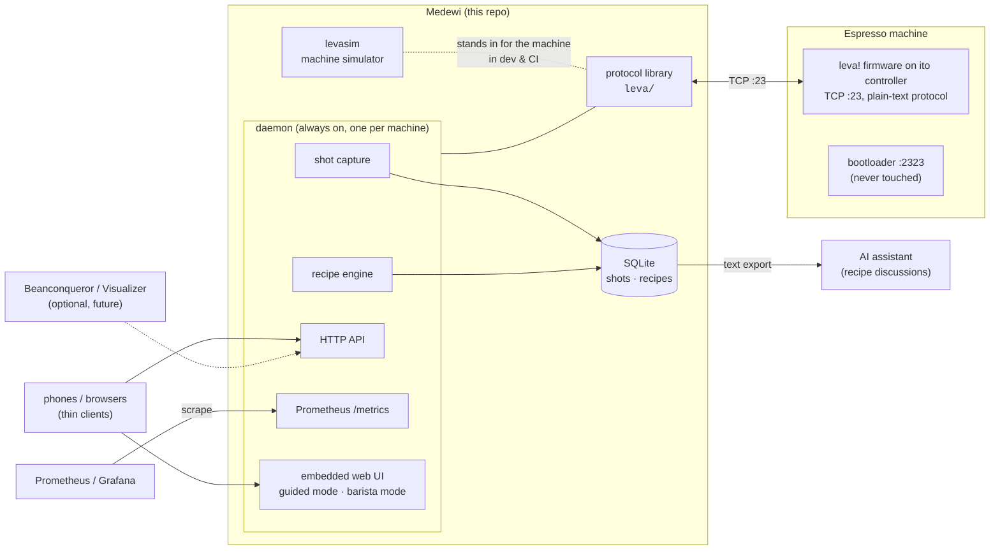

# Medewi — Architecture

For the "why" behind the shape described here, see the
[decision records](decisions/). For what the system is for, see
[use cases](use-cases.md).

## Components

## The pieces

- **Protocol library (`leva/`)** — owns the single TCP connection to the
  machine: sends commands, demultiplexes command responses from the
  continuous telemetry stream, decodes stream records using the firmware
  release's Status-Monitor XML as the format spec (loaded at runtime from a
  configured path — every installation has its own copy; it is vendor
  content and is never committed here).
- **levasim** — a fake leva! speaking the same TCP protocol, replaying
  fixtures recorded from a real machine. It is what makes development and
  CI possible without a hot espresso machine, and it carries a tripwire
  port that fails loudly if any tooling ever tries to reach a bootloader.
- **Daemon** — exactly one daemon owns machine and data. It captures every
  shot into the database (the firmware itself stores no curves), executes
  recipes ("make the machine ready for coffee X / drink Y" = select
  profile, dose, setpoint), serves the HTTP API and the embedded web UI,
  and exposes machine-health metrics for Prometheus. Runs on the
  **brewhost**; phones are thin clients.
- **Database** — SQLite. Shots are events with identity (timestamp, coffee,
  drink, recipe version, curves, optional verdict); recipes carry their
  edit history. Exports to LLM-friendly text.
- **Raw traffic log** — the daemon also keeps the last days of machine
  traffic as gzip JSON-lines files (`rawlog/`), minus license-key replies.
  `levalog events` turns them (and levacap captures) back into readable
  lines for troubleshooting; `levalog fields`, `runs` (with `--stats`)
  and `summary` list the report fields, the pump runs with statistics, and
  what each source holds. The handshake
  names the session's XML; `rawlog` repeats it as an `xml:` note at the top
  of each later file.

## Deployment modes

1. **Reference setup (now):** daemon on the **brewhost** — the role name
   for the always-on host (any home server) that runs medewid,
   Prometheus/Grafana and the operator's backup machinery; all phones are
   browsers.
2. **Display phone (planned evaluation):** the daemon plus a kiosk UI on an
   always-plugged Android phone mounted at the machine — a server with a
   screen in the right place.
3. **Single-phone, no server (future, for other users):** the core embedded
   in a mobile app. Documented trade: no multi-user recipes, and capture
   only happens while the app is open. The pure-Go/no-cgo policy exists to
   keep this path (gomobile) open.

## Releasing the machine

The daemon can give the machine up until a given time (`medewictl
release`, `POST /api/release`) so that another client (a conformance
run, a firmware flash) gets a clean line. The release end is persisted in
the database, so it holds across a daemon restart; while it lasts the
daemon sends nothing, not even at startup or shutdown, and the
supervision loop does not reconnect. It ends at the stored time or on
`medewictl reclaim`. A brew open when the connection ends is stored with
a truncated kind naming the cause (`truncated-lost`, `truncated-released`,
`truncated-shutdown`, `truncated-crash`). See the
[design](superpowers/specs/2026-11-08-release-machine-design.md).

## Phase 2 packages (implemented)

- `watch/` — machine-state detector over the decoded report stream
  (READY, steam, eco events).
- `brew/` — brew recorder: pump runs as episodes, classification, curves.
- `store/` — SQLite persistence of brews and their curves. Settings
  backups are files that `medewictl backup` writes, not database rows.
- `rawlog/` — raw traffic log: gzip'd per-session JSON lines, allowlist
  that keeps license-key replies out, retention, marks as notes, the
  session's XML name as an `xml:` note in every file.
- `daemon/` — connection supervision, HTTP API, metrics, ops panel
  (`panel.html`, embedded), power control, machine READY (`[READY]`),
  display sampling and marks.
- `cmd/medewid` — the daemon binary (mTLS API, plaintext health listener).
- `cmd/medewictl` — client for status, power, release/reclaim, marks and backups.
- `logview/` — offline decoding of raw logs and captures: opens files
  (also a cut or still-written gzip), selects raw logs for a time window,
  reassembles and classifies lines (reports via the vendor XML, display
  frames, banners, glued records) and redacts `MCu`/`MCm` dumps with the
  same rules as `rawlog`. It also names the report fields (stable keys
  from the XML), finds pump runs and wand draws with `brew.Recorder`,
  picks the XML per session, and filters, projects and formats events as
  text, JSON Lines or CSV. It streams: a `Stream` decodes one file at a
  time and hands on entry by entry, so memory stays bounded by one file;
  `levalog` reads its input twice when it needs the runs first (a
  `RunFinder` pass keeps only run metadata, a `Selector` pass writes).
  Kept out of `main` so a later remote reader (#30) can reuse it.
- `systime/` — the `systemd.time(7)` subset every command accepts for
  timestamps and spans, plus pflag values for them
  ([CLI conventions](cli-conventions.md)).
- `cmd/levalog` — `levalog fields`, `runs`, `events` (with `--every`) and
  `summary` over `logview`, installed on brewhost by the module.
- `nix/module.nix` — the `nixosModules.medewid` service.

## Build order

1. Capture session against the real machine → protocol fixtures.
2. Simulator + protocol library (developed against the fixtures).
3. Daemon: exporter, shot capture → DB, HTTP API — **implemented** (phase 2);
   recipe execution is still to come.
4. Web UI: guided mode and barista mode.
5. Extensions: hot-water dosing, steam guidance, settings push via the
   firmware's Virtual-LCD protocol, V60 program, optional
   Beanconqueror/Visualizer clients.
